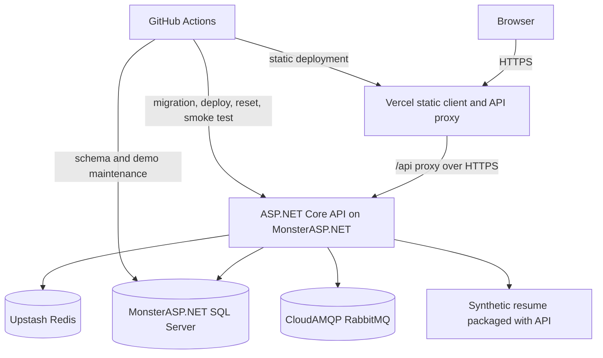

# Pursuit zero-cost public demo hosting design

> **Superseded on 2026-10-10:** MonsterASP.NET Free cannot satisfy Pursuit's
> production TLS validation, backup, availability, or usage requirements. The
> replacement design is
> `docs/superpowers/specs/2026-10-10-pursuit-portable-public-demo-hosting-design.md`.

Date: 2026-10-09

## Objective

Publish Pursuit as a recruiter-facing demo that can be explored without local setup. The deployment must preserve the verified .NET, SQL Server, Redis, RabbitMQ, authentication, tenant-isolation, migration and browser-workflow behavior.

The service must cost $0, require no Azure subscription or payment card, and remain reproducible if a free provider changes its limits. The result is a public portfolio demo. It is not a commercial production environment and must not hold real applicant data.

## Constraints and success criteria

The approved constraints are:

- Vercel serves the React client and proxies `/api/*` requests.
- MonsterASP.NET runs the ASP.NET Core API and the SQL Server database.
- Upstash supplies Redis over TLS.
- CloudAMQP supplies RabbitMQ over TLS.
- GitHub Actions runs tests, database migrations, deployment, scheduled reset and pre-migration export.
- Public visitors use one-click Employer and Job Seeker demo access.
- Public registration is disabled in the hosted demo.
- Administrator access stays private.
- Visitors use a bundled synthetic resume. They cannot upload personal files.
- Local Docker Compose keeps SQL Server, Redis, RabbitMQ and Azurite.
- Azure Blob Storage remains a supported storage implementation.

The demo is ready to publish when a new visitor can load the client, enter either public role, complete the matching workflow, and see a clear message during backend wake-up. The deployed commit and dependency health must be visible without exposing secrets.

## Current system facts

Pursuit is a modular monolith. One ASP.NET Core process serves the HTTP API and runs the RabbitMQ consumer. SQL Server is authoritative. Redis holds disposable search results, Azure Blob Storage holds resumes, and RabbitMQ carries application-submitted events.

Several database paths use SQL Server directly:

- refresh-token rotation uses `UPDLOCK` and `HOLDLOCK`;
- refresh-token-chain revocation uses a recursive SQL Server CTE;
- administrator bootstrap uses `sys.sp_getapplock`;
- EF Core migrations and the checked migration bundle target SQL Server;
- integration and browser tests provision SQL Server containers.

A PostgreSQL move would replace these tested paths and their migration history. This design keeps SQL Server.

The browser uses HttpOnly access and refresh cookies, a Strict antiforgery cookie, and origin checks for unsafe requests. A same-origin browser route is therefore part of the security boundary.

## Options reviewed

### Vercel or Netlify for the whole application

Serverless execution conflicts with the current process model. The RabbitMQ consumer needs a live process, Data Protection needs persistent keys, and the database still needs a SQL Server host. Vercel's Function body limit also sits below Pursuit's current 5 MB resume limit. Reworking these parts around platform queues, workflows and storage would replace working infrastructure.

This option is rejected.

### MonsterASP.NET for both client and backend

This keeps one origin and the smallest deployment surface. The first request after IIS sleep would also delay the React shell, leaving no reliable place to explain that the demo is waking.

This option remains the fallback if Vercel proxy behavior fails the compatibility gate.

### Vercel client with a MonsterASP.NET backend

This is selected. Vercel serves the client immediately and forwards `/api/*` to the external API. MonsterASP.NET keeps .NET 10, IIS and SQL Server. The visible browser origin stays on Vercel, subject to the cookie and CSRF checks in the compatibility gate.

## System shape

## Compatibility gate

Provider documentation is insufficient evidence for this application. The first implementation phase is a disposable deployment probe. Permanent demo-mode work starts after every required check passes.

The probe must prove:

1. A framework-dependent .NET 10 application starts under IIS.
2. The API stays below the 256 MB memory ceiling during startup and the full browser journey. The target is a peak below 220 MB, leaving room for host variation.
3. The hosted SQL account can run the current migrations, locking hints, recursive CTE and `sp_getapplock` paths.
4. A migration bundle can reach the hosted database from GitHub Actions and from an approved operator machine.
5. IIS preserves Data Protection keys in an existing absolute directory across an application-pool recycle and a deployment.
6. Manual HTTPS activation works on the free MonsterASP.NET subdomain.
7. Vercel forwards `Set-Cookie`, `Cookie`, `Origin`, multipart requests, status codes and response headers correctly through an external rewrite.
8. Strict cookies, refresh rotation, logout and CSRF rejection pass through the Vercel URL.
9. Upstash works with `StackExchange.Redis` over TLS and still follows the existing immediate cache-miss policy during outage.
10. CloudAMQP works with the RabbitMQ client over TLS, retains a durable message across an API recycle, and delivers it after the consumer reconnects.
11. The complete Employer to Job Seeker to Employer Playwright flow passes against the hosted URL.
12. A cold backend produces the approved startup experience rather than a blank page or unexplained error.

Failure of checks 2, 3, 5, 7, 8, 10 or 11 rejects the hybrid host. The fallback probe serves the compiled client from MonsterASP.NET. Failure of the fallback ends this hosting tranche without changing the database provider.

## Client and proxy design

The Vite production build uses a relative API base. Browser requests go to `/api/*` on the Vercel origin. Vercel forwards those paths to the MonsterASP.NET HTTPS origin and leaves application routes on the static client.

API responses must never be cached by the proxy. Static assets may use immutable cache headers when their filenames contain content hashes. `index.html` must use short-lived or revalidation caching so a deployment can replace it promptly.

The client owns backend wake-up handling. The first API request has three visible states:

- checking the service;
- starting the demo after a slow or failed first attempt;
- ready, or a specific unavailable message after bounded retries.

Retries use a fixed total time budget and stop cleanly. Authentication requests start after readiness succeeds. The interface must remain keyboard accessible and must not trap the visitor on the startup screen.

Vercel deployment is the last release step. This prevents a new client from reaching an older API during a normal release. Production deployment from `main` runs through GitHub Actions after CI and backend smoke checks; an automatic Vercel production deployment from an unchecked push must be disabled.

## Authentication and request security

The browser sees the Vercel hostname. Host-only cookies returned through the proxy should therefore bind to that hostname. The compatibility gate must prove this behavior before the design relies on it.

Production cookies keep `HttpOnly`, `Secure`, `Path=/` and `SameSite=Strict`. The CSRF token remains required for unsafe browser requests. `Cors:AllowedOrigins` and the browser-origin policy contain the exact Vercel production origin and one fixed Vercel staging-project origin. Random preview origins are excluded.

The MonsterASP.NET address remains reachable for health and deployment checks. Direct browser mutation requests without an accepted origin still fail CSRF validation. Public registration is disabled through configuration and enforced by the API; hiding the registration page is supplementary.

The administrator account is created once through the existing bootstrap path. Its bootstrap credentials are removed after creation. Public pages contain no administrator credential, shortcut or login hint.

## Demo access and data

The home and login screens provide explicit Employer demo and Job Seeker demo actions. Each action calls a dedicated demo-login endpoint. The endpoint is enabled only when `Demo:Enabled=true`, accepts a fixed role value rather than arbitrary credentials, and signs in the configured seeded account through the normal token and cookie services.

The shared demo accounts retain normal authorization rules. Their credentials are random deployment secrets and never appear in the client bundle or repository.

The deterministic seed contains:

- one employer tenant and employer account;
- one job-seeker account;
- several open and closed jobs;
- one existing application for employer review;
- at least one open job that the seeded seeker has not applied to;
- realistic synthetic names, descriptions, dates and statuses;
- no personal information copied from a real person.

Shared accounts can collide when two visitors act at once. The UI must treat duplicate applications and changed job state as ordinary shared-demo outcomes. The reset restores the starting scenario each night. Session-specific cloned tenants are outside this tranche because they add allocation, cleanup and abuse-control work before the public demo has measured traffic.

## Resume handling

Local development keeps the existing PDF and DOCX upload flow through `AzureBlobStorageService` and Azurite. The public demo registers a demo storage implementation behind `IBlobStorageService`.

The demo application action uses a packaged synthetic PDF. The file lives outside the public static directory and is returned only through the existing employer authorization path. The stored application value is an internal storage identifier, not a public filesystem path.

Demo mode rejects multipart visitor uploads at the API boundary. This removes personal-data retention, malware handling and storage growth from the public environment. The client labels the action as using a synthetic demonstration resume.

## Database migrations and release order

The API still does not migrate its database at startup. Deployment uses a Windows-compatible EF Core migration bundle because MonsterASP.NET runs IIS on Windows. Existing Linux bundle generation remains in CI for Docker deployment.

Each release follows this order:

1. Complete backend, frontend, integration and browser CI.
2. Export the synthetic hosted database before a schema change.
3. Build both Linux and Windows migration bundles from the reviewed commit.
4. Run the Windows bundle with the migration connection.
5. Stop when the bundle exits non-zero.
6. Publish the framework-dependent ASP.NET Core application through Web Deploy.
7. Run direct backend liveness and readiness checks.
8. Deploy the candidate client to a fixed Vercel staging project and run the hosted smoke journey through its approved origin.
9. Deploy the Vercel production client and proxy configuration.
10. Verify the public revision and complete role journeys.

Separate migration and API SQL identities remain the target. The compatibility gate records whether the free database permits creation of both identities and the required grants. A provider restriction that forces one identity is documented as a demo-host exception and may not be copied into a paid environment.

Schema rollback remains forward-only. A failed migration blocks deployment. The previous application artifact may be redeployed only when it is compatible with the current schema.

## Reset, export and recovery

A small demo-maintenance executable owns deterministic seeding and reset. It reuses the domain and persistence model without starting the web host, Redis connection, RabbitMQ consumer or blob client.

The nightly GitHub Actions job:

1. acquires a SQL application lock;
2. revokes demo refresh tokens;
3. removes visitor-created applications and jobs inside the demo tenant;
4. restores deterministic entities and statuses with stable identifiers;
5. verifies expected row counts and tenant ownership;
6. records success without printing connection strings or passwords.

The reset transaction may invalidate an active session at the documented reset time. The client handles the resulting 401 by returning to the demo entry screen.

The free database has no provider backup guarantee. Before every schema-changing release, GitHub Actions creates a short-retention export containing synthetic data only. Recovery uses the latest schema bundle followed by deterministic seed, so the demo does not depend on retaining mutable visitor data.

## Cache and messaging

Upstash is configured through a TLS endpoint and secret password. Redis remains optional for correctness. Connection failure must return an immediate cache miss, and SQL Server remains authoritative.

CloudAMQP is configured through a TLS URI containing host, port, virtual host and credentials. The RabbitMQ connection factory must support that URI without removing local host-and-port configuration.

The free IIS worker can sleep. RabbitMQ delivery therefore has eventual timing in the demo. Durable queued messages survive the sleep and are consumed after the next wake. The planned transactional outbox remains required so a broker outage cannot turn a committed application into an apparent failed submission.

Future work requiring guaranteed continuous processing exceeds the free-host contract and triggers a backend-host review.

## Health and revision visibility

Keep a process liveness endpoint and add dependency-aware readiness. SQL Server is required for readiness. Redis follows its cache-fallback policy and therefore appears as degraded rather than unavailable. RabbitMQ and demo storage report their current state separately.

A public metadata response exposes:

- application name;
- sanitized commit SHA;
- build timestamp;
- demo mode state;
- next scheduled reset time;
- liveness and readiness links.

It must not expose connection strings, provider credentials, internal paths, exception details or administrator state.

## Resource and abuse controls

The public environment needs tighter limits than local development:

- registration is disabled;
- demo login has per-IP and global rate limits;
- authentication, refresh and mutation routes have rate limits;
- JSON and multipart body limits are explicit;
- page size and search length stay bounded;
- visitor file upload is disabled;
- logs omit credentials, tokens and resume contents;
- database reset removes visitor mutations;
- free-tier usage alerts are enabled where the provider supports them.

No provider receives a payment method. Automatic paid upgrades remain disabled.

## Portability rules

Host-specific work stays in deployment configuration and composition code. Application and domain projects cannot depend on Vercel or MonsterASP.NET packages.

The repository keeps:

- the Linux Docker image;
- local Docker Compose;
- Windows/IIS publish support;
- SQL Server migrations;
- storage, cache and messaging interfaces;
- environment-based provider selection;
- hosted smoke tests that receive a base URL.

Each material feature must include a deployment-impact note covering memory, background execution, scheduled work, persistent files, outbound networking, database changes and free-tier quotas. A feature that exceeds the selected host's contract pauses public deployment until the backend moves or the feature design changes.

The Vercel public URL stays stable when the backend moves. Changing the external rewrite target is sufficient when the API contract and cookie behavior remain compatible.

## Observability and operations

Serilog writes structured console output for provider capture. File logging is allowed only in a persistent, bounded directory and cannot be the sole diagnostic record.

Deployment and nightly-reset workflows retain concise logs and failure artifacts. A scheduled public smoke check covers client load, readiness, both demo logins and one read-only role action. Mutation-heavy workflow verification runs after reset or deployment to avoid altering the shared demo at arbitrary times.

Provider dashboards and GitHub Actions are the initial operational surface. Paid monitoring, tracing and log aggregation are outside the $0 constraint.

## Failure behavior

| Failure | Public behavior | Operator action |
| --- | --- | --- |
| Monster IIS asleep | Vercel loads and shows bounded startup progress | None unless wake-up exceeds the time budget |
| SQL Server unavailable | Readiness fails and API requests return a stable service error | Inspect provider status and connection settings |
| Redis unavailable | Searches use SQL after an immediate cache miss | Inspect Upstash quota and TLS connection |
| RabbitMQ unavailable | Outbox retains pending work after that milestone is implemented | Inspect CloudAMQP quota and connection |
| Synthetic resume unavailable | Application creation or authorized download returns a stable error | Verify packaged asset and storage registration |
| Nightly reset fails | Existing demo state remains; workflow reports failure | Run maintenance manually after diagnosis |
| Vercel deployment fails | Previous static deployment remains live | Inspect build and route configuration |
| Backend deployment fails | Vercel continues to target the last working backend revision where possible | Redeploy the last compatible artifact |

## Verification

Automated checks required before publication:

- existing backend integration suite passes;
- frontend lint, component tests and production build pass;
- migration bundles build and run against clean and current SQL Server databases;
- demo-mode configuration and startup validation tests pass;
- public registration rejection is covered;
- demo login permits only the two configured roles;
- demo storage rejects visitor uploads and serves the synthetic resume only to an authorized employer;
- reset is idempotent and cannot cross the demo tenant boundary;
- Redis TLS and outage behavior are covered;
- RabbitMQ TLS, durable delivery and reconnect behavior are covered;
- proxy cookie, refresh, logout and CSRF tests pass against the Vercel URL;
- desktop and mobile Playwright journeys pass against the hosted candidate;
- accessibility checks pass on the startup, login and role workflow screens;
- hosted metadata reports the deployed commit;
- `git diff --check` is clean.

Manual checks required before the repository links to the demo:

- HTTPS is active on both public and backend hosts;
- no real resume or personal data exists in the hosted database or files;
- public credentials expose no administrator access;
- the cold-start message appears before the backend responds;
- memory remains below the compatibility-gate ceiling;
- provider dashboards show expected free-plan usage;
- reset and recovery instructions have been rehearsed;
- the live URL works in a signed-out browser on desktop and mobile.

## Documentation changes during implementation

Update:

- `README.md` with the live-demo link, public roles, architecture, free-host limitations and local setup;
- `docs/demo-guide.md` with public and local workflows;
- `docs/production-configuration.md` with demo settings, TLS endpoints, IIS Data Protection path and deployment secrets;
- `docs/architecture.md` with the hosted request path and provider adapters;
- `docs/portfolio-roadmap.md` after hosted verification proves the milestone;
- a deployment runbook with migration, publish, smoke, reset, export and recovery commands.

## Non-goals

- Commercial production hosting or an uptime guarantee.
- Storing real applicant resumes or personal data.
- Migrating from SQL Server to PostgreSQL.
- Replacing RabbitMQ with Vercel Queues or Netlify Functions.
- Purchasing a domain or paid monitoring.
- Building session-specific demo tenants before shared-demo traffic proves the need.
- Supporting unbounded future workloads inside a fixed free tier.

## Acceptance criteria

This tranche is complete when the compatibility gate passes, the hosted architecture follows this document, the full local and hosted verification sets pass, the deterministic reset succeeds on schedule, the deployment can be rebuilt from a clean checkout, documentation matches the live behavior, the changes are committed and pushed, hosted CI is green, and the public URL is verified after deployment.
